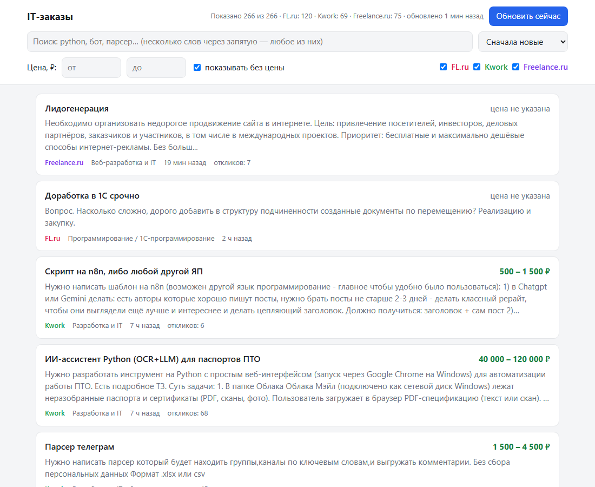

# Freelance Job Aggregator

[Русская версия](README.ru.md)

A self-hosted web app that collects fresh IT / software-development gigs from six freelance marketplaces, Reddit and Telegram channels every 10 minutes and shows them in a single filterable feed.



## Features

- **8 sources, one feed:** FL.ru, Kwork, Freelance.ru, Freelancejob.ru, Workspace.ru, Freelancer.com, Reddit and public Telegram channels
- **Normalized budgets:** prices in USD, EUR, INR, etc. are converted to a single currency using the daily Central Bank rate; the original amount is shown next to it
- **Offline auto-translation:** English gigs are translated into Russian locally with Meta's NLLB-200 model via [transformers.js](https://huggingface.co/docs/transformers.js) (no external API, no limits; ~0.9 GB model downloaded once to `data/models`; set `TRANSLATE=0` to disable). The original is one click away
- **Client country flag:** Russian marketplaces → Russia; Freelancer.com → country of the project currency (USD is shown as unknown)
- **De-duplication:** when a Telegram channel reposts a gig from a marketplace, it appears only once
- **Budget filter** (min / max), with an option to hide gigs without a stated budget
- **Keyword search** with OR-logic (`python, bot, scraper`)
- **Sorting** by date or budget
- **"New since your last visit"** highlighting
- Filters persist between sessions
- Background auto-refresh plus a manual "refresh now" button

## Sources

| Source | How data is obtained | What is collected |
|---|---|---|
| FL.ru | Official RSS feeds | Programming, Websites |
| Kwork | JSON embedded in the project board page | Development & IT |
| Freelance.ru | HTML parsing | Web development & IT, AI |
| Freelancejob.ru | HTML parsing | Main feed filtered by IT keywords + "Programmers" section |
| Workspace.ru | HTML parsing, open tenders only | Websites, mobile apps, CRM, game dev |
| Freelancer.com | Official public API | Projects where most required skills are IT-related |
| Reddit | Official OAuth API (free key) | Hiring posts from r/forhire, r/slavelabour and others |
| Telegram | Public channel web preview `t.me/s/<channel>` | Channels listed in `channels.json` |

Requests are rate-limited (pauses between pages, at most one cycle every 10 minutes). Sites that block automated clients (Cloudflare challenges, login walls) are intentionally **not** scraped.

### Reddit setup

Reddit requires an API key for any automated access. It is free:

1. Log in to Reddit and open https://www.reddit.com/prefs/apps
2. Click **create another app…**, choose type **script**, set *redirect uri* to `http://localhost:8080` (required but unused).
3. Copy `reddit.example.json` to `reddit.json` and fill in `client_id` (the string under the app name) and `client_secret`.

`reddit.json` is git-ignored. Until it exists, the status bar shows Reddit as "not configured". The subreddit list and the tag that marks a hiring post (`[Hiring]`, `[Task]`…) can be changed in the same file.

### Telegram channels

Channels are configured in `channels.json`:

```json
{ "username": "job_developer", "itFilter": false }
```

- `username` — channel name without `@`; the channel must be public (reachable at `https://t.me/s/<username>`).
- `itFilter: true` — for mixed channels: only posts whose headline contains IT keywords are kept.

Posts where freelancers advertise themselves (résumés) are dropped automatically. Changes are picked up on the next refresh — no restart needed.

## Getting started

Requires [Node.js](https://nodejs.org/) 18+.

**Windows:** double-click `start.bat` — it installs dependencies and opens http://localhost:3000.

**Windows, as a desktop app:** create a shortcut to `wscript.exe "<path>\app\launch.vbs"` with the icon `app\icon.ico`. It starts the server in the background (no console window, output goes to `data\server.log`) and opens the feed in a standalone Edge window. Closing the window keeps the server collecting orders; `app\stop.vbs` stops it.

**Manually:**
```bash
npm install
npm start
```

Set the `PORT` environment variable to use a different port.

## Architecture

```
server.js            HTTP server, refresh scheduler, persistence (data/orders.json)
sources/
  common.js          HTTP helper, price/date parsing, IT keyword dictionary, FX rate
  fl.js              FL.ru (RSS)
  kwork.js           Kwork
  freelanceru.js     Freelance.ru
  freelancejob.js    Freelancejob.ru
  workspace.js       Workspace.ru (tenders)
  freelancer.js      Freelancer.com (REST API)
  reddit.js          Reddit (OAuth API)
  telegram.js        Telegram channels
channels.json        Telegram channel list
reddit.example.json  Reddit config template
public/index.html    UI: filters and feed (vanilla HTML/CSS/JS)
```

Every source is a single async function that returns gigs in a common shape (`id`, `title`, `description`, `url`, `price`, `priceMax`, `category`, `date`). Adding a new marketplace means writing one module in `sources/` and registering it in `server.js`. A failing source never breaks the others — its error is shown in the status bar while the rest of the feed keeps updating.

## Tech stack

Node.js (built-in `http` and `fetch`, no framework), [cheerio](https://cheerio.js.org/) for HTML/RSS parsing, vanilla HTML/CSS/JS front end with no build step.

> The UI is currently in Russian, since most of the sources are Russian-language marketplaces.
