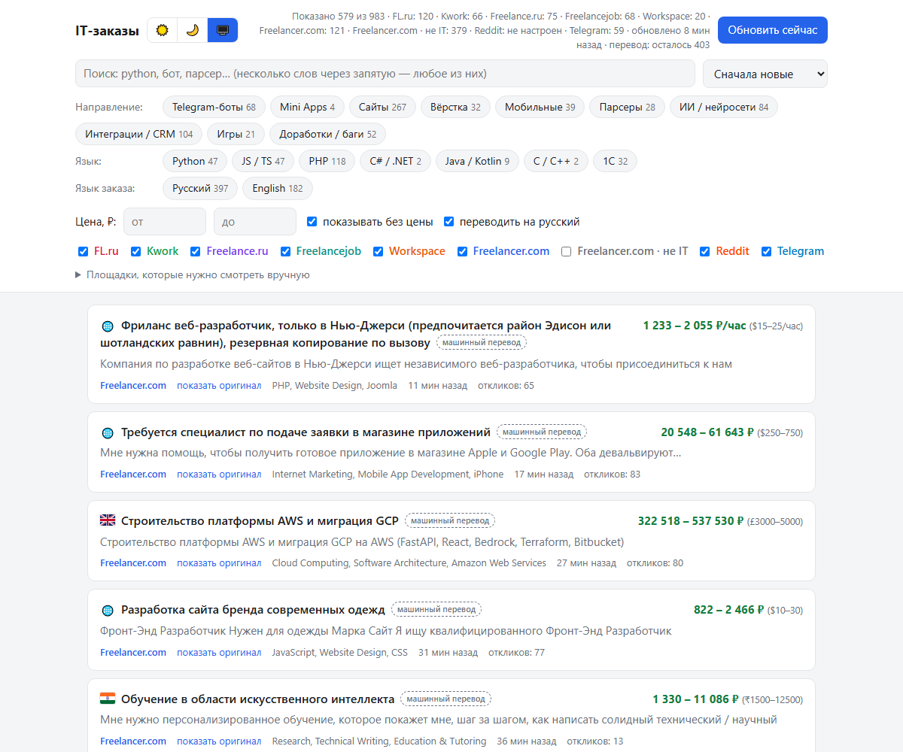

# Агрегатор IT-заказов

[English version](README.md)

Программа для Windows, которая каждые 10 минут собирает свежие IT-заказы с фриланс-бирж и Telegram-каналов и показывает их в одной ленте: с фильтрами, автопереводом английских заказов и пометками, откуда пришёл заказ.

Работает целиком на твоём компьютере: никаких аккаунтов, подписок и облачных серверов. Открывается ярлыком на рабочем столе, как обычное приложение.



## Содержание

- [Что умеет](#что-умеет)
- [Установка](#установка)
- [Как пользоваться](#как-пользоваться)
- [Откуда берутся заказы](#откуда-берутся-заказы)
- [Настройка](#настройка)
- [Частые проблемы](#частые-проблемы)
- [Для разработчиков](#для-разработчиков)
- [Совместная работа через GitHub](#совместная-работа-через-github)

---

## Что умеет

- **8 источников в одной ленте:** FL.ru, Kwork, Freelance.ru, Freelancejob.ru, Workspace.ru, Freelancer.com, Telegram-каналы и Reddit (Reddit — после настройки ключа, см. ниже).
- **Только IT:** с каждой площадки берутся разделы про разработку; со смешанных площадок — заказы, прошедшие фильтр IT-слов.
- **Быстрые фильтры** по направлению (боты, сайты, парсеры, мобильные…), языку программирования (Python, JS, PHP…) и языку заказа (русский / английский).
- **Фильтр по цене** «от» и «до», поиск по словам, сортировка по дате или цене.
- **Все цены в рублях:** доллары, евро, рупии и т. д. пересчитываются по курсу ЦБ, исходная сумма показана рядом.
- **Автоперевод** английских заказов на русский — прямо на компьютере, без интернет-сервисов. Переведённые заказы помечены «машинный перевод», оригинал — в один клик.
- **Флаг страны заказчика** (где её можно узнать).
- **Подсветка новых заказов** с прошлого открытия.
- **Без дублей:** если Telegram-канал пересылает заказ с биржи, он показывается один раз.
- **Светлая и тёмная тема.**
- **Список площадок для ручного просмотра** (Upwork, Reddit, PeoplePerHour…) с готовыми ссылками на поиск.
- Все настройки и фильтры запоминаются.

---

## Установка

Нужен компьютер с **Windows 10 или 11** и ~2 ГБ свободного места (из них ~0,9 ГБ — модель перевода).

### 1. Установи Node.js

Node.js — это программа, на которой работает агрегатор. Ставится один раз.

- Открой https://nodejs.org, скачай версию **LTS** и установи с настройками по умолчанию (просто «Next» до конца).
- Или одной командой в терминале (Win+R → `cmd` → Enter):
  ```
  winget install OpenJS.NodeJS.LTS
  ```

Проверить, что всё установилось: в новом окне терминала набери `node -v` — должна появиться версия, например `v24.x.x`.

### 2. Получи папку агрегатора

- **Архивом:** распакуй `freelance-aggregator.zip` (правый клик → «Извлечь всё»).
- **Через GitHub** (если тебя добавили в репозиторий):
  ```
  git clone https://github.com/Kirihiroy/freelance-aggregator.git
  ```

Положи папку туда, где она будет лежать постоянно, например `C:\Users\<твоё имя>\freelance-aggregator`. Не в «Загрузки» и не в Program Files.

### 3. Создай ярлыки

Дважды кликни файл **`app\install-shortcuts.vbs`** в папке агрегатора. На рабочем столе появятся два ярлыка:

| Ярлык | Что делает |
|---|---|
| **IT-заказы** | Открывает агрегатор в отдельном окне. Если сервер ещё не запущен — запускает его в фоне |
| **IT-заказы — выключить** | Полностью выключает фоновый сервер |

> Если потом переместишь папку агрегатора — запусти `install-shortcuts.vbs` ещё раз, ярлыки обновятся.

### 4. Первый запуск

Открой ярлык **IT-заказы**.

- Первый запуск занимает **1–3 минуты**: скачиваются библиотеки (~500 МБ). Появится сообщение об этом, окно откроется само.
- Затем один раз скачивается **модель перевода** (~0,9 ГБ). Заказы видны сразу, а в строке состояния вверху написано «перевод: загрузка модели…». Когда модель скачается, английские заказы начнут переводиться.
- Первые заказы появляются через ~30 секунд после запуска (сервер обходит все площадки).

Совет: правый клик по значку окна на панели задач → **«Закрепить на панели задач»**.

---

## Как пользоваться

### Как работает сервер

Агрегатор состоит из двух частей:

1. **Сервер** — невидимая программа, которая каждые 10 минут обходит площадки и сохраняет заказы.
2. **Окно** — то, что ты видишь. Просто показывает то, что собрал сервер.

**Закрытие окна не выключает сервер** — он продолжает собирать заказы в фоне, и при следующем открытии все новые заказы уже будут на месте (и подсвечены). Выключить сервер — ярлык «IT-заказы — выключить». После перезагрузки компьютера сервер сам не запускается: его включает первый клик по ярлыку «IT-заказы».

### Шапка

| Элемент | Что делает |
|---|---|
| ☀️ 🌙 🖥️ | Тема: светлая, тёмная или как в Windows |
| Строка состояния | Сколько заказов показано, сколько собрано с каждой площадки, когда было обновление, сколько осталось перевести. Красное «ошибка» — площадка не ответила (наведи мышь, чтобы увидеть причину) |
| **Обновить сейчас** | Не ждать 10 минут, обойти площадки прямо сейчас |

### Фильтры

- **Поиск** — слова через запятую работают как «или»: `бот, парсер, python` покажет заказы, где есть хотя бы одно из слов. Ищет и в оригинале, и в переводе.
- **Быстрые фильтры** (кнопки-«таблетки»). Число на кнопке — сколько сейчас таких заказов.
  - **Направление:** Telegram-боты, Mini Apps, Сайты, Вёрстка, Мобильные, Парсеры, ИИ / нейросети, Интеграции / CRM, Игры, Доработки / баги.
  - **Язык:** Python, JS / TS, PHP, C# / .NET, Java / Kotlin, C / C++, 1С.
  - **Язык заказа:** Русский / English — удобно, чтобы смотреть только иностранных заказчиков.
  - Внутри одной группы кнопки работают через «или», между группами — через «и». Пример: «Telegram-боты» + «Python» + «English» = англоязычные заказы на ботов на Python.
  - Кнопки ищут ключевые слова в тексте заказа, поэтому иногда ошибаются — это подсказка, а не точная классификация.
- **Цена, ₽ от / до.** Заказ с вилкой цен (например, 5 000 – 20 000) показывается, если вилка пересекается с твоим диапазоном.
- **Показывать без цены** — у многих заказов цена «договорная»; сними галочку, чтобы их скрыть.
- **Переводить на русский** — общий выключатель перевода.
- **Галочки площадок** — включить / выключить отдельные источники. «Freelancer.com · не IT» выключен по умолчанию (там дизайн, тексты, маркетинг).
- **Сортировка:** сначала новые / дорогие / дешёвые.

### Карточка заказа

- **Заголовок** — ссылка на сам заказ на площадке. Откликаться нужно там.
- **Флаг** перед заголовком — страна заказчика (наведи мышь — увидишь страну и откуда она взята):
  - 🇷🇺 — заказ с российской биржи;
  - флаг другой страны — Freelancer.com, страна определена **по валюте заказа** (рупии → Индия, фунты → Великобритания);
  - 🌐 — страна неизвестна (заказы в долларах, Telegram, Reddit).
- **Цена** — в рублях; в скобках исходная сумма. «₽/час» — почасовая оплата.
- **Описание** — первые 3 строки; клик по описанию разворачивает его.
- **Нижняя строка:** площадка, раздел или канал, когда опубликован, сколько уже откликов. «● новый» — появился с прошлого открытия (у таких карточек жёлтая полоса слева).

### Автоперевод

- Английские заказы переводятся нейросетью **NLLB-200** (Meta) прямо на компьютере. Интернет-сервисы не используются, лимитов нет.
- Переведённый заказ помечен значком **«машинный перевод»**. Ссылка **«показать оригинал»** внизу карточки показывает английский текст, **«перевести»** — возвращает перевод.
- Сначала переводятся заголовки, потом описания; новые заказы — первыми. Один заголовок — ~1,5 секунды. Прогресс — в строке состояния.
- Качество хорошее, но не идеальное: нейросеть иногда путает слова. **Перед откликом всегда читай оригинал.**
- Перевод нагружает 2 ядра процессора, остальные свободны.

### Площадки для ручного просмотра

Внизу шапки — раскрывающийся список **«Площадки, которые нужно смотреть вручную»**: Reddit, Upwork, PeoplePerHour, Workana, Guru, Fiverr, Freelancehunt, Weblancer. Эти сайты нельзя собирать автоматически (нужен вход, ключ или стоит защита от ботов), поэтому там готовые ссылки на поиск свежих заказов — открываешь и смотришь сам.

---

## Откуда берутся заказы

| Площадка | Как получаем | Что берём |
|---|---|---|
| **FL.ru** | Официальные RSS-ленты | Разделы «Программирование» и «Сайты» |
| **Kwork** | Страница биржи проектов (до 10 страниц) | «Разработка и IT» |
| **Freelance.ru** | Страницы заказов (3 страницы) | «Веб-разработка и IT», «ИИ и нейросети» |
| **Freelancejob.ru** | Страницы заказов | Общая лента с фильтром IT-слов + «Работа для программистов» |
| **Workspace.ru** | Страницы тендеров (по 2 страницы) | Только открытые тендеры: сайты, приложения, CRM, геймдев |
| **Freelancer.com** | Официальный открытый API (500 последних заказов) | IT — если хотя бы треть навыков заказа про программирование и заголовок не про SEO, промпты, рекламу и т. п. Остальное — в «Freelancer.com · не IT» |
| **Telegram** | Публичная веб-версия каналов `t.me/s/<канал>` | Каналы из `channels.json` |
| **Reddit** | Официальный API (нужен ключ) | Посты-заказы из r/forhire, r/slavelabour и др. |

Сейчас подключены Telegram-каналы:

| Канал | Что там |
|---|---|
| @job_developer | IT-заказы (часто дубли с Kwork — они склеиваются) |
| @zakazy_it, @freelancetaverna, @workk_on, @digitaltender | Смешанные каналы — берутся только посты с IT-словами в заголовке |
| @allgigs | Ежедневный дайджест **зарубежных** фриланс-заказов; разбивается на отдельные заказы, берутся разделы «Разработка» и «Аналитика» |

**Правила, которых держится агрегатор:**
- запросы к площадкам — с паузами и не чаще раза в 10 минут;
- сайты, которые защищаются от программ (Cloudflare, вход по паролю), **не обходятся** — для них есть ручные ссылки;
- заказы хранятся 14 дней, потом удаляются.

---

## Настройка

### Telegram-каналы — `channels.json`

```json
{ "username": "job_developer", "itFilter": false, "note": "комментарий для себя" }
```

| Поле | Значение |
|---|---|
| `username` | Имя канала без `@`. Канал должен быть публичным и открываться по адресу `https://t.me/s/<username>` |
| `itFilter` | `true` — для смешанных каналов: брать только посты, у которых в первой строке есть IT-слова |
| `digest` | `true` — канал публикует подборки (один пост = много заказов по разделам «📌 Раздел») |
| `sections` | Для дайджестов: какие разделы брать, например `["Разработка"]` |
| `skipUrls` | Для дайджестов: пропускать заказы со ссылками на эти сайты (например, сайты вакансий в штат) |
| `lang` | `"en"` — заказчики иностранные (для фильтра «Язык заказа»), даже если текст по-русски |

Посты, где фрилансеры рекламируют себя («меня зовут…», «ищу заказы», резюме), отбрасываются автоматически. Изменения подхватываются при следующем обновлении — перезапуск не нужен.

### Reddit — `reddit.json`

Reddit не отдаёт данные без ключа API, а с конца 2025 года выдаёт ключи только после одобрения заявки. Если у тебя получится создать приложение:

1. https://www.reddit.com/prefs/apps → **create another app…** → тип **script**, redirect uri `http://localhost:8080`.
2. Скопируй `reddit.example.json` в `reddit.json` и впиши `client_id` (строка под названием приложения) и `client_secret`.

Если при создании видишь «Max clients have been reached» — Reddit не даёт новым аккаунтам создавать приложения без заявки. Тогда пользуйся ссылками на Reddit в блоке ручных площадок. `reddit.json` не попадает в git.

### Переменные окружения

| Переменная | По умолчанию | Что делает |
|---|---|---|
| `PORT` | `3000` | Порт сервера (адрес будет `http://localhost:<PORT>`) |
| `TRANSLATE` | включено | `TRANSLATE=0` — выключить автоперевод (не скачивать модель, не грузить процессор) |

Ярлык всегда открывает порт 3000. Переменные нужны в основном при запуске вручную.

### Запуск без ярлыков

- `start.bat` — запуск с видимым окном консоли (там виден журнал работы); закрыть окно консоли = выключить сервер.
- Вручную: `npm install`, затем `npm start` и открыть http://localhost:3000.

---

## Частые проблемы

| Проблема | Что делать |
|---|---|
| Ярлык ничего не открывает / «The server did not start» | Проверь, что установлен Node.js (`node -v` в терминале). Посмотри файл `data\server.log` в папке агрегатора — там причина |
| Окно пустое, «Сервер не отвечает» | Сервер выключен — открой ярлык «IT-заказы» заново |
| Площадка показывает «ошибка» | Наведи мышь на «ошибка» — увидишь причину. Чаще всего площадка временно недоступна или поменяла вёрстку. Остальные источники работают |
| Перевод долго «загрузка модели…» | Модель ~0,9 ГБ скачивается один раз — при медленном интернете это может занять время. Если в строке «перевод: ошибка» — наведи мышь, увидишь причину |
| Компьютер тормозит | Это перевод в первые минуты после большой порции новых заказов. Выключить перевод совсем: `TRANSLATE=0` |
| На панели задач серый глобус вместо иконки | Закрой окно агрегатора полностью и открой ярлыком снова |
| Переместил папку — ярлыки не работают | Запусти `app\install-shortcuts.vbs` ещё раз |
| Порт 3000 занят другой программой | Запусти с другим портом: `set PORT=3001 && npm start` |

---

## Для разработчиков

### Устройство

```
server.js              HTTP-сервер, обновление раз в 10 минут, хранение в data/orders.json
translator.js          фоновый перевод EN→RU (NLLB-200 через transformers.js)
sources/
  common.js            загрузка страниц, разбор цен и дат, словарь IT-слов, курс ЦБ
  fl.js                FL.ru (RSS)
  kwork.js             Kwork (JSON внутри страницы)
  freelanceru.js       Freelance.ru (HTML)
  freelancejob.js      Freelancejob.ru (HTML)
  workspace.js         Workspace.ru (HTML, тендеры)
  freelancer.js        Freelancer.com (REST API) + отбор IT / не IT
  telegram.js          Telegram-каналы и дайджесты
  reddit.js            Reddit (OAuth API)
public/index.html      весь интерфейс: HTML + CSS + JS без фреймворков и сборки
app/
  launch.vbs           ярлык «IT-заказы»: сервер в фоне + окно Edge (--app)
  stop.vbs             ярлык «выключить»
  install-shortcuts.vbs  создаёт оба ярлыка
  icon.ico, icon.png   иконка (рисуется скриптом make-icon.ps1)
channels.json          список Telegram-каналов
reddit.example.json    шаблон настроек Reddit
data/                  (не в git) заказы, журнал server.log, модель перевода
```

**Стек:** Node.js (встроенные `http` и `fetch`), [cheerio](https://cheerio.js.org/) для разбора HTML и RSS, [transformers.js](https://huggingface.co/docs/transformers.js) для перевода, чистые HTML/CSS/JS.

### Формат заказа

Каждый источник — асинхронная функция, которая возвращает массив заказов такого вида:

```js
{
  id: 'kwork:123456',        // уникальный id: '<площадка>:<id на площадке>'
  source: 'Kwork',           // название площадки (как в списке в public/index.html)
  title: 'Нужен Telegram-бот',
  description: 'Текст заказа…',
  url: 'https://kwork.ru/projects/123456',
  price: 5000,               // в рублях или null
  priceMax: 15000,           // верх вилки или null
  priceUnit: null,           // 'час' для почасовых
  priceNote: '$50–150',      // исходная сумма в валюте
  category: 'Разработка и IT',
  date: '2026-11-22T10:00:00.000Z',
  offers: 3,                 // число откликов или null
  country: null,             // код страны ('IN', 'GB') или null
}
```

Если функция возвращает `null` — источник «не настроен» (как Reddit без ключа). Если бросает ошибку — в строке состояния будет «ошибка», остальные источники продолжают работать. Сервер сам добавляет `firstSeen` (когда заказ впервые увиден) и `tr` (перевод).

### Как добавить новую площадку

1. Создай `sources/<имя>.js`, экспортируй `async function` по образцу соседних файлов. Для загрузки страниц используй `get()` из `common.js` (там правильный User-Agent и таймаут), для цен — `parsePrice()`, для фильтра IT — `IT_WORDS`.
2. Подключи его в `SOURCES` в `server.js`.
3. Добавь название в массив `SOURCES` в `public/index.html` (и цвет в CSS `.src.<Имя>`, если хочется).
4. Если площадка российская — добавь её в `RU_SOURCES` в `public/index.html` (для флага 🇷🇺).
5. Проверь отдельно: `node -e "require('./sources/<имя>')().then(r => console.log(r.length, r[0]))"`.

### Подводные камни

- **Обратные слэши.** В регулярных выражениях много `\b`, `\d`. Если генерировать файлы через `sed` / heredoc в bash, `\\` легко превращается в `\` или в спецсимвол — потом фильтры молча перестают работать.
- **Кириллица и `\b`.** В JavaScript `\b` работает только для латиницы, поэтому для русских слов используется `(?<![а-яё])бот` — иначе «бот» найдётся в «работа».
- **VBS-файлы с русскими буквами** нужно сохранять в UTF-16 (как `install-shortcuts.vbs`), иначе Windows покажет кракозябры.
- **Не обходить защиту сайтов.** Если площадка отвечает Cloudflare-проверкой или требует вход — добавляем её в ручные ссылки (`MANUAL_LINKS` в `public/index.html`), а не пытаемся обмануть.

---

## Совместная работа через GitHub

Репозиторий приватный; доступ даётся через **Settings → Collaborators → Add people**.

Получить обновления:
```
git pull
```

Предлагаемый порядок работы вдвоём:
1. Каждая доработка — в своей ветке: `git switch -c имя-доработки`.
2. Закончил — `git push -u origin имя-доработки` и открой **Pull Request** на GitHub.
3. Второй смотрит изменения, и PR вливается в `main`.

Так вы не затрёте работу друг друга. Файлы с данными и ключами (`data/`, `reddit.json`, `node_modules/`) в git не попадают — у каждого свои.
